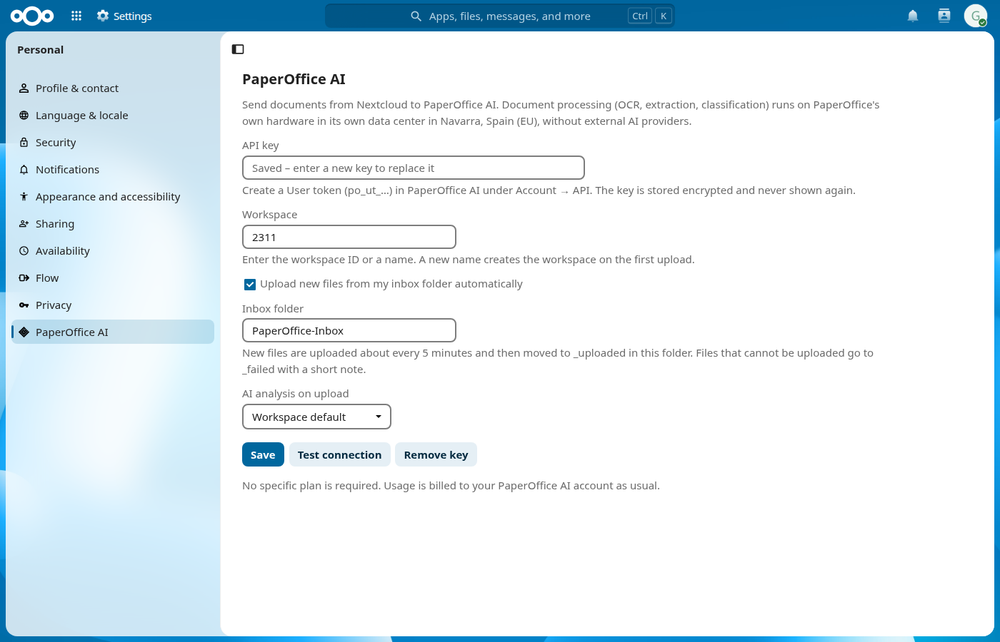
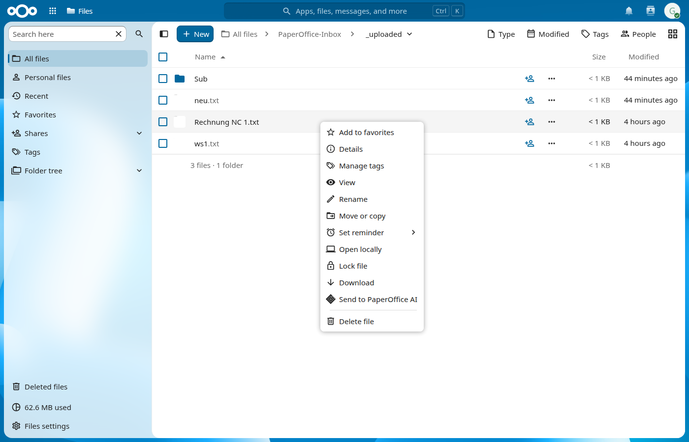

# PaperOffice AI for Nextcloud

Nextcloud app (`paperoffice_ai`) that sends documents from Nextcloud to [PaperOffice AI](https://paperoffice.ai).

- **Inbox folder:** each user picks a folder in their own files (default `PaperOffice-Inbox`). A background job uploads new files every 5 minutes, then moves them to `_uploaded`. Files that cannot be uploaded go to `_failed`, each with a short note.
- **Send to PaperOffice AI:** a file action in the Files app sends a single file right away.
- **Your own key:** each user connects with their own PaperOffice AI API key (User token `po_ut_…`; Group tokens `po_gt_…` and Secret keys `po_sk_…` also work). The key is stored encrypted and never shown again.
- **Admin control:** administrators can limit PaperOffice AI to certain groups. Keys of users outside these groups are removed automatically; every user can always remove their own key.

Document processing (OCR, extraction, classification) runs on PaperOffice's own hardware in its own data center in Navarra, Spain (EU), without external AI providers.

A PaperOffice AI account and API key are required. No specific plan is required. Usage is billed to your PaperOffice AI account as usual.

## Requirements
- Nextcloud 31–35
- PHP 8.1 or later
- Outbound HTTPS to `api.paperoffice.ai`

## Install
Install the app from the Nextcloud App Store. To install it manually, copy this repository to `custom_apps/paperoffice_ai` and run `occ app:enable paperoffice_ai`. Then open **Personal settings → PaperOffice AI**.

## Limitations
- Files are copied to PaperOffice AI. Results (extracted fields, searchable PDFs) are not written back to Nextcloud.
- Files are never deleted in Nextcloud. Processed inbox files are moved to `_uploaded`.
- The app skips received shares and external storage in the inbox. It also does not send shared files whose owner has blocked downloads.
- Uploads without a clear answer from PaperOffice AI are never repeated automatically; the file goes to `_failed` with a note.

## API
https://api.paperoffice.ai/latest/docs/llms.txt

## License
MIT, © PaperOffice Enterprise Operations, S.L.U.

## Screenshots

